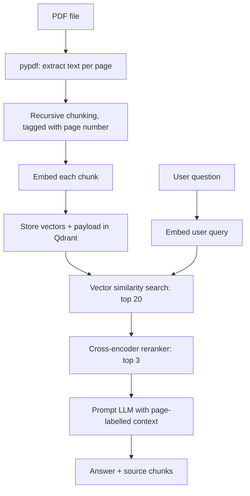
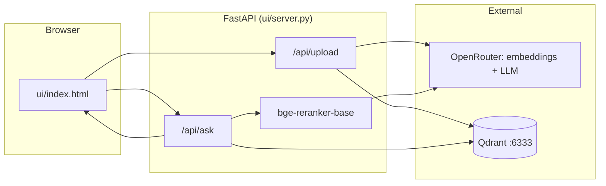

# Document QnA with PDF RAG

This project is a Retrieval-Augmented Generation (RAG) application for answering questions from a PDF file.

The system reads a PDF, extracts text, splits it into chunks, converts each chunk into an embedding, stores those embeddings in Qdrant, retrieves the most relevant chunks for a user question, and then sends that context to an LLM to generate the final answer.

The repo has two versions of the pipeline:

| | `main.py` | `ui/` web app |
|---|---|---|
| How you use it | Script with a hard-coded PDF and question | Browser: upload any PDF, ask questions |
| Chunking | Fixed 500-character slices | Recursive, token-sized chunks with page numbers |
| Retrieval | Top 3 by vector similarity | Top 20 by vector similarity, reranked to top 3 |
| Answer | Plain text | Text with page labels, plus the source chunks and their scores |
| Qdrant collection | `rag_fundamentals_1` | `rag_ui` |

`main.py` is the minimal, beginner-friendly version. The web app is where improvements from [advance_rag.md](advance_rag.md) are being added step by step.

## High-level flow



## Architecture diagram



## What the web app does step by step

**Upload (`/api/upload`)**
1. Reads the uploaded PDF with `pypdf`, page by page
2. Splits each page into chunks of up to 500 tokens (75 overlap), breaking on paragraphs, then sentences, then words
3. Tags each chunk with its page number and filename
4. Embeds every chunk with `openai/text-embedding-3-small` (via OpenRouter)
5. Replaces the `rag_ui` collection in Qdrant with the new chunks

**Ask (`/api/ask`)**
1. Embeds the question and fetches the 20 closest chunks from Qdrant
2. Re-scores those 20 with a cross-encoder reranker (`BAAI/bge-reranker-base`) and keeps the best 3
3. Builds the context with page labels like `[p. 8]` and asks the LLM (`deepseek/deepseek-v4.1-flash`)
4. Returns the answer plus each source chunk's page, rerank score and vector score

## Project structure

- `main.py` — the original pipeline script (basic RAG)
- `ui/server.py` — FastAPI backend for the web app (improved RAG)
- `ui/index.html` — single-page frontend: upload, ask, view answer and sources
- `ui/README.md` — short run guide for the web app
- `advance_rag.md` — improvement plan with drop-in code for `ui/server.py`, and progress
- `sample-text-only-pdf-a4-size.pdf` — sample PDF used in the demo
- `requirements.txt` — Python dependencies for both the script and the web app
- `.env` — API key configuration (not committed)
- `.vscode/settings.json` — points VS Code at `.venv` so autocomplete works

## Environment setup

Create a `.env` file in the project root:

```env
OPENROUTER_API_KEY=your_api_key_here
```

Start Qdrant locally (needs Docker):

```bash
docker run -p 6333:6333 qdrant/qdrant
```

## Install dependencies

```bash
python3 -m venv .venv
source .venv/bin/activate
pip install -r requirements.txt
```

`sentence-transformers` pulls in PyTorch, and the reranker model (~1 GB) downloads the first time the server starts.

## Run

**Web app**

```bash
source .venv/bin/activate
uvicorn ui.server:app --reload
```

Open http://localhost:8000, upload a PDF and ask a question.

- `--reload` restarts the server automatically when you save a `.py` file.
- To stop it, press `Ctrl + C` in its terminal, or run `lsof -ti :8000 | xargs kill`.
- If the page shows stale data after a change, hard-refresh with `Cmd + Shift + R`.
- Uploaded documents are kept in Qdrant, but the server forgets which one is loaded when it restarts, so upload again after a restart.

**Script**

```bash
python main.py
```

## Key code concepts

### PDF extraction (per page)

```python
pages = [page.extract_text() or "" for page in reader.pages]
```

Text is kept per page, so each chunk can remember which page it came from.

### Chunking

```python
splitter = RecursiveCharacterTextSplitter.from_tiktoken_encoder(
    chunk_size=500, chunk_overlap=75
)
for page_no, page_text in enumerate(pages, start=1):
    for piece in splitter.split_text(page_text):
        if piece.strip():
            chunks.append({"text": piece, "page": page_no})
```

Chunks are sized in tokens and split on natural boundaries (paragraphs → sentences → words), so they don't stop mid-word. Blank pieces are skipped. On the sample PDF this raised the best match score from 0.248 (fixed 500-character slices in `main.py`) to 0.408.

### Embedding generation

```python
embeddings = embedding_model.embed_documents([c["text"] for c in chunks])
```

This converts each chunk into a 1536-dimension vector that captures its meaning.

### Qdrant storage

```python
models.PointStruct(
    id=i,
    vector=emb,
    payload={"chunk_id": i, "filename": file.filename, **chunk},  # text + page
)
```

Each chunk is stored as a vector, with its text, page number and filename in the payload.

### Retrieval and reranking

```python
candidates = qdrant.query_points(..., limit=20).points
scores = reranker.predict([(question, c.payload["text"]) for c in candidates])
ranked = sorted(zip(candidates, scores), key=lambda x: x[1], reverse=True)
```

Vector search is fast but approximate. The cross-encoder reads the question and each chunk *together*, which is slower but more accurate, so it's only run on the top 20.

Two different scores come back for each source:

| Score | From | Scale |
|---|---|---|
| `vector_score` | Qdrant cosine similarity | about 0.2–0.5 for typical matches |
| `rerank_score` | Cross-encoder | 0–1; high (> 0.5) only when a chunk directly answers the question |

Don't reuse a cosine threshold for rerank scores. Broad questions like "what is the theme of the document?" get very low rerank scores (< 0.01) because no single chunk answers them. `retrieve_and_rerank()` accepts a `min_score` cutoff, but it's off by default.

### LLM answer generation

```python
context = "\n\n".join(f"[p. {r.payload['page']}] {r.payload['text']}" for r, _ in results)
```

The reranked chunks are labelled with their page numbers and sent to the LLM, which answers using only that context.

## Why this is useful

This pattern is the foundation of modern document Q&A systems:

- search relevant knowledge from large documents
- reduce prompt size by selecting only the important chunks
- ground the answer in the document instead of relying on model memory alone

## Roadmap

Improvements are tracked in [advance_rag.md](advance_rag.md), with code for each step.

- [x] Recursive, token-based chunking with page metadata
- [x] Reranker (retrieve 20, keep 3) with both scores shown in the UI
- [x] Web UI and REST API
- [ ] Score threshold and a reusable `dense_search`
- [ ] System prompt with "I don't know" and page citations
- [ ] Evaluation set (recall@k, MRR, faithfulness)
- [ ] Hybrid search (dense + BM25)
- [ ] Multiple documents, restore state after restart, background indexing
- [ ] Chat history, streaming answers
- [ ] Better PDF parsing, multi-query / HyDE, query routing

## Summary

This project is an end-to-end RAG pipeline for PDF Q&A. `main.py` shows the core idea in its simplest form: store document chunks as vectors, search for the most relevant ones, and ask the LLM to answer from them. The web app builds on it with structure-aware chunking, page metadata and reranking, and is being extended step by step.
