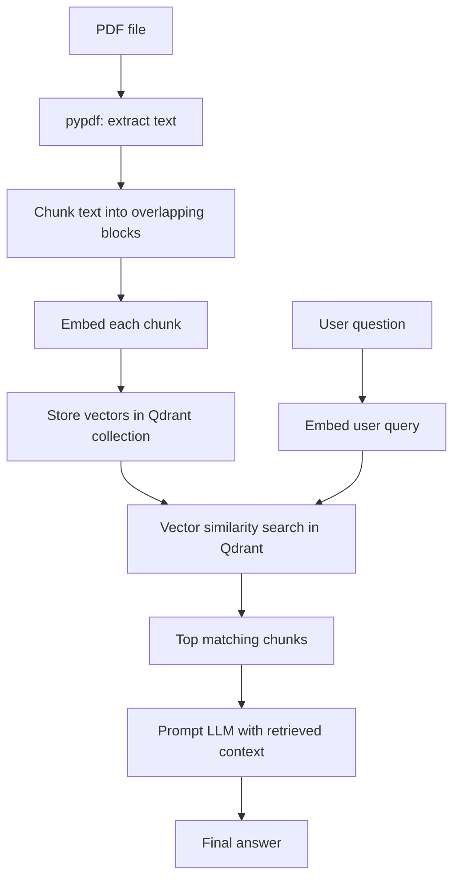
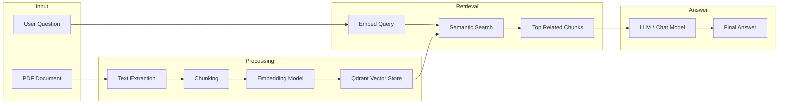

# Document QnA with PDF RAG

This project is a simple Retrieval-Augmented Generation (RAG) application for answering questions from a PDF file.

The system reads a PDF, extracts text, splits it into chunks, converts each chunk into an embedding, stores those embeddings in Qdrant, retrieves the most relevant chunks for a user question, and then sends that context to an LLM to generate the final answer.

This repo is meant to be a practical beginner-friendly example of how a real document Q&A pipeline works in production-style architecture.

## High-level flow



## Architecture diagram



## What it does step by step

1. Reads the PDF file using `pypdf`
2. Extracts text page by page
3. Splits the text into small overlapping chunks
4. Converts each chunk into a vector using an embedding model
5. Stores those vectors in a Qdrant collection named `rag_fundamentals_1`
6. Embeds the user question
7. Searches Qdrant for the closest matching chunks
8. Sends the retrieved chunks as context to the LLM
9. Returns an answer grounded in the retrieved document content

## Example flow

```text
PDF -> Page text -> Chunks -> Embeddings -> Qdrant
                                             |
User query -> Query embedding -> Similarity search -> Relevant chunks -> LLM answer
```

## Project structure

- `main.py` — the main pipeline script
- `README.md` — project explanation and architecture overview
- `.env` — environment configuration for API keys
- `sample-text-only-pdf-a4-size.pdf` — sample PDF used in the demo
- `requirement.txt` — Python dependencies

## Environment setup

Create a `.env` file in the project root:

```env
OPENROUTER_API_KEY=your_api_key_here
```

## Install dependencies

```bash
python3 -m venv .venv
source .venv/bin/activate
pip install -r requirement.txt
```

## Run the app

```bash
python main.py
```

## Key code concepts

### PDF extraction

```python
text = "\n".join(page.extract_text() or "" for page in reader.pages)
```

This combines all extracted page text into a single string.

### Chunking

```python
return [text[i:i+size] for i in range(0, len(text), step)]
```

This creates overlapping text segments so the model can work with smaller, more relevant blocks.

### Embedding generation

```python
embeddings = embedding_model.embed_documents(chunks)
```

This converts each chunk into a vector representation that captures semantic meaning.

### Qdrant storage

```python
qdrant.upsert(
    collection_name=COLLECTION_NAME,
    points=points
)
```

Each chunk gets stored as a vector with payload metadata such as the chunk text and index.

### Retrieval

```python
ans = qdrant.query_points(
    collection_name=COLLECTION_NAME,
    query=embedded_user_query,
    limit=3,
    with_payload=True,
).points
```

This retrieves the most relevant chunks for the current user question using vector similarity search.

### LLM answer generation

```python
context = "\n\n".join(result.payload["text"] for result in ans)
```

The most relevant chunks are assembled into a context string and sent to the LLM for answer generation.

## Why this is useful

This pattern is the foundation of modern document Q&A systems:

- search relevant knowledge from large documents
- reduce prompt size by selecting only the important chunks
- ground the answer in the document instead of relying on model memory alone

## Notes

This is intentionally a simple implementation for learning and experimentation. In a production system, you would usually add:

- better chunking strategies
- metadata filtering
- logging and monitoring
- retry logic and error handling
- vector indexing tuning
- evaluation and benchmarking
- a frontend or API layer

## Next improvements

- try different chunk sizes and overlap values
- add metadata such as page numbers
- use a larger or more specialized embedding model
- build a web app or REST API around this pipeline
- compare exact vs approximate retrieval strategies

## Summary

This project is a minimal end-to-end RAG pipeline for PDF Q&A. It shows the key idea clearly: store document chunks as vectors, search the most relevant chunks for a question, and ask the LLM to answer using that retrieved context.
